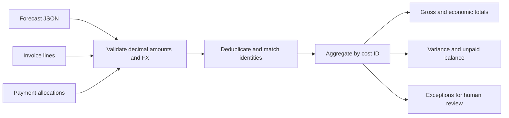

# Architecture

The CLI is a thin wrapper around a pure `reconcile(data)` function. Monetary arithmetic uses Decimal; conversion and aggregation retain precision, and output is rounded to cents. Rounding differences can occur between displayed rows and totals. One FX rate per currency per run is a deliberate simplifying assumption; real FX settlement may require transaction-specific rates. Completeness cannot be inferred merely from presence of rows. Data stays local unless the operator shares it. Proposed future work: input schema versioning, reconciliation by shipment, explicit quote scope and Incoterm allocation, credit notes, audit log and allocation of one payment across invoice lines.
